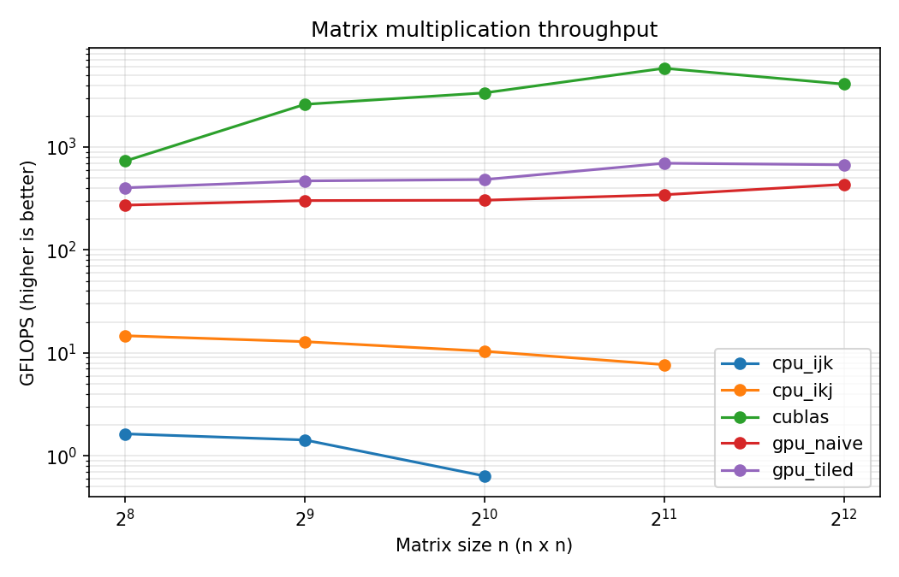

# GPU Matrix Multiplication Benchmark (C + CUDA)

Square matrix multiplication (C = A × B, float32) implemented four ways and benchmarked side by side:

| Version | What it does |
|---|---|
| `cpu_ijk` / `cpu_ikj` | Single-threaded C. Same math, two loop orders, to show the effect of cache-friendly memory access. |
| `gpu_naive` | One CUDA thread per output element, reading A and B straight from global memory. |
| `gpu_tiled` | Each 16×16 thread block loads tiles of A and B into shared memory and reuses them, cutting global memory traffic. |
| `cublas` | NVIDIA's tuned library, used as the upper bound. |

Every GPU result is checked against the CPU result (max relative error < 1e-3) before it is reported.

## Results

GPU: **NVIDIA Tesla T4 (Google Colab)**

| n | CPU ikj (ms) | GPU naive (ms) | GPU tiled (ms) | cuBLAS (ms) | Tiled vs CPU |
|---|---|---|---|---|---|
| 256 | 2.29 | 0.123 | 0.083 | 0.046 | 27× |
| 512 | 20.9 | 0.889 | 0.572 | 0.103 | 36× |
| 1024 | 207 | 7.06 | 4.45 | 0.639 | 47× |
| 2048 | 2,233 | 49.9 | 24.7 | 2.95 | 91× |
| 4096 | (skipped) | 317 | 204 | 33.6 | |

All GPU results matched the CPU reference to within 1e-6 relative error (cuBLAS within 3e-6).



**Takeaways:**
- Reordering the CPU loops from `ijk` to `ikj` made the C baseline 4.6× faster at n=1024 (3,373 ms → 739 ms), purely from better cache use.
- Shared-memory tiling made the GPU kernel 2.0× faster than the naive kernel at n=2048, and 91× faster than the single-threaded CPU.
- The tiled kernel reached about 700 GFLOPS, 12% of cuBLAS (5,800 GFLOPS). The gap shows how much further optimizations like register tiling and vectorized loads can go.
- cuBLAS throughput dropped at n=4096 compared with n=2048, likely because the T4 lowers its clock speed under sustained load.

## How to run

On Google Colab (free GPU): open `run_on_colab.ipynb`, set Runtime → Change runtime type → T4 GPU, and run the cells.

On any Linux machine with the CUDA toolkit:

```bash
make
./matmul_cpu 256 512 1024
./matmul_gpu 256 512 1024 2048
```

## What I learned

**Why loop order matters on the CPU.** In row-major storage, the `ijk` loop walks down a column of B, jumping `n` floats per step and missing the cache. Reordering to `ikj` walks along rows instead, so memory access is sequential and the same math runs faster.

**Why the naive kernel is slow.** Each multiply-add needs two loads from global memory, so the kernel spends most of its time waiting on memory rather than computing.

**Why tiling helps.** A block of 16×16 threads cooperatively loads one 16×16 tile of A and one of B into shared memory, then every thread reuses those values. Each value fetched from global memory is used 16 times instead of once. `__syncthreads()` makes sure the tile is fully loaded before anyone reads it, and fully used before it is overwritten.

**Why cuBLAS is still faster.** It adds techniques this project does not: each thread computes several outputs (register tiling), vectorized loads, double buffering to overlap loads with math, and tuning for each GPU architecture.

**Measuring correctly.** Kernels are timed with CUDA events after a warm-up launch and averaged over 5 runs. Host-to-device copy time is reported separately, because for small matrices the copy can cost more than the computation.
